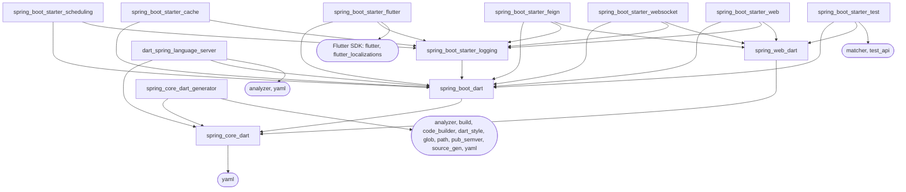

# Dependencies

Every package the spring_core_dart family uses, who publishes it, what
depends on what, and the rule that decides what may be added.

> **The rule: only packages of the Dart and Flutter teams.** The packages
> of this repository use each other, the Dart SDK, the Flutter SDK and
> packages published on pub.dev by the Dart and Flutter teams. Everything
> else is forbidden, transitive dependencies included, unless it is listed
> as an exception with a reason ([section 2](#2-exceptions)). CI enforces
> it.

**Contents**

1. [The rule](#1-the-rule)
2. [Exceptions](#2-exceptions)
3. [The packages of this repository](#3-the-packages-of-this-repository)
4. [Graph of the repository's packages](#4-graph-of-the-repositorys-packages)
5. [What an application gets](#5-what-an-application-gets)
6. [Code generation](#6-code-generation)
7. [Tests](#7-tests)
8. [Lints, the language server and the workspace tools](#8-lints-the-language-server-and-the-workspace-tools)
9. [Every package](#9-every-package)
10. [Outside pub.dev](#10-outside-pubdev)
11. [Adding a dependency](#11-adding-a-dependency)

---

## 1. The rule

**Allowed:**

| Source | What it is |
|---|---|
| This repository | `spring_core_dart`, `spring_boot_dart`, the starters, the generator, the language server, the examples |
| The Dart SDK | `dart:core`, `dart:async`, `dart:io`, ... (no package needed) |
| The Flutter SDK | `flutter`, `flutter_localizations`, `flutter_test` and what the SDK pins (`sky_engine`) |
| pub.dev publisher `dart.dev` | Core Dart team packages: `test`, `path`, `collection`, `async`, `build`, `lints`, ... |
| pub.dev publisher `tools.dart.dev` | Dart team tooling: `analyzer`, `build_runner`, `source_gen`, `yaml`, `dart_style`, ... |
| pub.dev publisher `labs.dart.dev` | Dart team experiments (none used today) |
| pub.dev publisher `flutter.dev` | Flutter team packages: `flutter_lints`, `vector_math`, ... |
| pub.dev publisher `google.dev` | Google packages the Dart team maintains: `json_annotation`, `checked_yaml`, `webkit_inspection_protocol` |

**Forbidden:** any other package. That covers other publishers
(`invertase.io`, `verygood.ventures`, people's own domains), packages
without a verified publisher, and git or path dependencies from outside
this repository. **Transitive dependencies count too**: a Dart team package
that pulls in a third-party package is forbidden, unless it is an exception.

**Stricter for what ships in applications.** The packages that end up in
an application's `dependencies` (`spring_core_dart`, `spring_boot_dart`,
`spring_web_dart`, every runtime starter: logging, scheduling, cache,
Feign, WebSocket, web, Flutter) depend only on packages of this
repository. Two things are allowed besides them:

- the Dart team's `yaml`, which parses `application.yml` (Spring Boot uses
  SnakeYAML for this);
- the Flutter SDK, for `spring_boot_starter_flutter`.

Not even other Dart team packages are allowed there.

**How it is checked.** `tool/check_dependencies.dart` asks pub.dev who
publishes each package the repository reaches and fails on anything
outside the rule. CI runs it on every push and pull request (the
`--flutter` run when a Flutter package is affected). The allowed publishers,
the runtime list and the exceptions are written in that file, which is the
source of truth.

```bash
dart pub get
dart run tool/check_dependencies.dart            # the pub workspace

# The Flutter packages resolve on their own (see section 3):
(cd spring_boot_starter_flutter && flutter pub get)
(cd example/flutter_counter && flutter pub get)
(cd example/flutter_themes && flutter pub get)
dart run tool/check_dependencies.dart --flutter
```

## 2. Exceptions

Each exception has a reason and, where possible, the packages that may
pull it (`allowedPackages` in `tool/check_dependencies.dart`). What an
exception depends on is allowed too, but only through it.

| Package | Publisher | Why it is allowed | Who may pull it |
|---|---|---|---|
| `melos` | `invertase.io` | Workspace scripts (`dart run melos run check`). It is a dev tool of the workspace root and is never a dependency of a package. | `spring_core_dart_workspace` only |
| `material_color_utilities` | `material.io` (Google's Material team) | `package:flutter` depends on it and the Flutter SDK pins its version, so it cannot be avoided. | the Flutter packages only |
| `node_preamble` | none | `package:test` (Dart team) pulls it for browser tests. It has no publisher on pub.dev. | any package (through `test`) |

What comes **only** through `melos`: `ansi_styles`, `conventional_commit`
(`invertase.io`), `cli_launcher` (`gabriel.terwesten.net`), `xml`,
`petitparser` (`lukas-renggli.ch`), `pub_updater` (`verygood.ventures`),
`prompts` (no publisher), `charcode` (`infimum.dk`), plus the Dart team's
`http`, `platform`, `process`, `yaml_edit` and the Flutter team's
`mustache_template`. None of them reach a package of the repository or an
application. Dropping `melos` (its scripts can run as `tool/*.dart`) would
remove all eight third-party packages.

## 3. The packages of this repository

Published packages go to pub.dev under one version for the whole family.
The examples, the language server and the workspace root are not
published.

| Package | What it is | Published | `dependencies` | `dev_dependencies` |
|---|---|---|---|---|
| `spring_core_dart` | Spring Core: dependency injection, configuration, profiles, events, SpEL, validation, AOP | yes | `yaml` | `build_runner`, `spring_boot_dart`, `spring_core_dart_generator`, `coverage`, `test` |
| `spring_core_dart_generator` | The code generator (`build_runner` builder) | yes | `spring_core_dart`, `analyzer`, `build`, `code_builder`, `dart_style`, `glob`, `path`, `pub_semver`, `source_gen`, `yaml` | `spring_boot_dart`, `build_test`, `coverage`, `package_config`, `test` |
| `spring_boot_dart` | Spring Boot: `@SpringBootApplication`, auto-configuration | yes | `spring_core_dart` | `build_runner`, `spring_core_dart_generator`, `test` |
| `spring_web_dart` | Spring Web: `@GetMapping`, `ResponseEntity`, server-sent events, HTTP and WebSocket client transports | yes | `spring_core_dart` | `test` |
| `spring_boot_starter_logging` | Logging: console, files, `logging.*` properties (the base starter) | yes | `spring_boot_dart` | `build_runner`, `spring_core_dart_generator`, `spring_boot_starter_test`, `test` |
| `spring_boot_starter_scheduling` | `@Scheduled`, `TaskScheduler` | yes | `spring_boot_dart`, `spring_boot_starter_logging` | same as logging |
| `spring_boot_starter_cache` | `@Cacheable`, `@CachePut`, `@CacheEvict`, `CacheManager` | yes | `spring_boot_dart`, `spring_boot_starter_logging` | same as logging |
| `spring_boot_starter_feign` | `@FeignClient` HTTP clients | yes | `spring_boot_dart`, `spring_boot_starter_logging`, `spring_web_dart` | same as logging |
| `spring_boot_starter_websocket` | `@WebSocketClient` clients; `@WebSocketEndpoint` server endpoints (served by the web starter) | yes | `spring_boot_dart`, `spring_boot_starter_logging`, `spring_web_dart` | same as logging |
| `spring_boot_starter_web` | Spring MVC: `@RestController`, the `dart:io` server, `ProblemDetail`, SSE, filters, CORS | yes | `spring_boot_dart`, `spring_boot_starter_logging`, `spring_web_dart` | `build_runner`, `spring_core_dart_generator`, `spring_boot_starter_test`, `spring_boot_starter_websocket`, `test` |
| `spring_boot_starter_flutter` | Flutter apps: `SpringApplicationWidget`, beans in widgets | yes | `flutter`, `flutter_localizations` (SDK), `spring_boot_dart`, `spring_boot_starter_logging` | `build_runner`, `spring_core_dart_generator`, `flutter_test` (SDK), `spring_boot_starter_test`, `lints` |
| `spring_boot_starter_test` | Tests (`springBootTest`, `@SpringBootTest`) | yes | `spring_boot_dart`, `spring_web_dart`, `matcher`, `test_api` | `test` |
| `dart_spring_language_server` (`extensions/language_server`) | Language server for the editor extensions | no | `spring_boot_dart`, `spring_core_dart`, `analyzer`, `yaml` | `test` |
| `spring_core_dart_example` (`example/spring_core_tour`) | Tour of every feature | no | `spring_boot_dart`, `spring_core_dart`, the logging, scheduling, cache, Feign and WebSocket starters | `build_runner`, `spring_boot_starter_test`, `spring_core_dart_generator`, `test` |
| `spring_boot_feign_example` (`example/spring_boot_feign`) | Feign, SSE and WebSocket against real servers | no | `spring_boot_starter_feign`, `spring_boot_starter_websocket` | `build_runner`, `spring_boot_starter_test`, `spring_core_dart_generator`, `test` |
| `flutter_counter`, `flutter_themes` (`example/`) | Flutter examples | no | `flutter` (SDK), `spring_boot_starter_flutter` | `build_runner`, `flutter_lints`, `flutter_test` (SDK), `spring_boot_starter_test`, `spring_core_dart_generator` |
| `spring_core_dart_workspace` (root) | The pub workspace | no | — | `lints`, `melos`, `path`, `test`, `yaml` |

**Two resolutions.** Everything except the Flutter packages is one pub
workspace with one `pubspec.lock` at the root. `spring_boot_starter_flutter`
and the two Flutter examples resolve on their own (each with its own
`pubspec.lock`) and reach the repository's packages by path. The reason is
that `flutter_test` pins `test_api`, which would hold the workspace's
`test` and `build_test` on an analyzer older than `build_runner` and
`source_gen` need. Applications are not affected.

## 4. Graph of the repository's packages

Runtime dependencies (`dependencies:`). An arrow reads "depends on".
External packages are shown only where they leave the repository.



The same as text:

```
spring_core_dart ─────────────── yaml
├── spring_boot_dart
│   ├── spring_boot_starter_logging
│   │   ├── spring_boot_starter_scheduling   (+ spring_boot_dart)
│   │   ├── spring_boot_starter_cache        (+ spring_boot_dart)
│   │   ├── spring_boot_starter_feign        (+ spring_boot_dart, spring_web_dart)
│   │   ├── spring_boot_starter_websocket    (+ spring_boot_dart, spring_web_dart)
│   │   ├── spring_boot_starter_web          (+ spring_boot_dart, spring_web_dart)
│   │   └── spring_boot_starter_flutter      (+ spring_boot_dart, Flutter SDK)
│   ├── spring_boot_starter_test             (+ spring_web_dart, matcher, test_api)
│   └── dart_spring_language_server          (+ spring_core_dart, analyzer, yaml)
├── spring_web_dart
└── spring_core_dart_generator               (+ the code generation packages, section 6)
```

**Re-exports.** Each package re-exports what it builds on, so an
application lists only the starter it chooses: `spring_boot_dart` exports
`spring_core_dart`; every starter exports `spring_boot_starter_logging`;
Feign, WebSocket and web export `spring_web_dart`. See
[roadmap/dependencies.md](../roadmap/dependencies.md).

**The WebSocket starter's server side runs on the web starter without
depending on it.** `spring_boot_starter_websocket` registers its
`WebSocketHandlerMapping` as a `HandlerMapping` of `spring_web_dart`; the
web starter's dispatcher asks every such bean. An application that wants
WebSocket endpoints lists both starters; one with WebSocket clients only
(a Flutter app) lists the WebSocket starter alone and starts no server.
The web starter has the WebSocket starter as a dev dependency only, for
its tests.

**Dev dependencies between the repository's packages.** Every package that
has an `example/` uses `build_runner` and `spring_core_dart_generator` to
generate it. The starters test with `spring_boot_starter_test`.
`spring_core_dart` has `spring_boot_dart` as a dev dependency for its
example, and the generator has it for its tests, because generated code
imports the runtime. Pub allows these cycles because they go through
`dev_dependencies`.

## 5. What an application gets

What an application downloads at run time when it lists one package of
the family. Packages of the repository are left out.

| The application lists | External packages at run time |
|---|---|
| `spring_core_dart`, `spring_boot_dart`, `spring_web_dart` or any Dart starter (logging, scheduling, cache, Feign, WebSocket, web) | 6: `yaml` and its dependencies `collection`, `path`, `source_span`, `string_scanner`, `term_glyph` |
| `spring_boot_starter_flutter` | the 6 above, plus the Flutter SDK (`flutter`, `flutter_localizations`, `sky_engine`) and what the SDK pins: `characters`, `clock`, `intl`, `material_color_utilities`, `meta`, `vector_math` |

All of them are Dart team packages, except `material_color_utilities`,
which is part of the Flutter SDK.

```
yaml                       tools.dart.dev
├── collection             dart.dev
├── source_span            tools.dart.dev
│   ├── collection
│   ├── path               dart.dev
│   └── term_glyph         tools.dart.dev
└── string_scanner         tools.dart.dev
    └── source_span

flutter                    Flutter SDK
├── characters             dart.dev
├── collection
├── material_color_utilities   material.io (exception)
│   └── collection
├── meta                   dart.dev
├── sky_engine             Flutter SDK
└── vector_math            flutter.dev
flutter_localizations      Flutter SDK
├── flutter
├── intl                   dart.dev
│   ├── clock              tools.dart.dev
│   ├── meta
│   └── path
└── path
```

The dev tools (`build_runner`, the generator, `spring_boot_starter_test`,
`test`) are build and test tools. They are never compiled into the
application.

## 6. Code generation

`spring_core_dart_generator` and `build_runner` are dev dependencies of
an application. Together they reach 50 packages, all from the Dart team.

```
spring_core_dart_generator
├── spring_core_dart
├── analyzer          → _fe_analyzer_shared, collection, convert, crypto, glob, meta,
│                       package_config, path, pub_semver, source_span, watcher, yaml
├── build             → analyzer, crypto, glob, logging, package_config, path
├── code_builder      → built_collection, built_value, collection, matcher, meta
├── dart_style        → analyzer, args, collection, package_config, path, pub_semver,
│                       source_span, yaml
├── glob              → async, collection, file, path, string_scanner
├── path
├── pub_semver        → collection
├── source_gen        → analyzer, async, build, dart_style, glob, path, pub_semver,
│                       source_span, yaml
└── yaml              → collection, source_span, string_scanner

build_runner          → analyzer, args, async, build, build_config, build_daemon,
                        built_collection, built_value, collection, convert, crypto,
                        dart_style, glob, graphs, http_multi_server, io, json_annotation,
                        logging, meta, mime, package_config, path, pool, pub_semver,
                        shelf, shelf_web_socket, stream_transform, watcher,
                        web_socket_channel, yaml
├── build_config      → checked_yaml, json_annotation, path, pubspec_parse
├── build_daemon      → built_collection, built_value, crypto, http_multi_server,
│                       logging, package_config, path, pool, pub_semver, shelf,
│                       shelf_web_socket, stream_transform, watcher,
│                       web_socket_channel, yaml
└── pubspec_parse     → checked_yaml, collection, json_annotation, pub_semver, yaml
```

`google.dev` packages on this path: `json_annotation` and `checked_yaml`,
through `build_config` and `pubspec_parse`.

## 7. Tests

| Package | Brings | Used by |
|---|---|---|
| `test` (`dart.dev`) | `test_core`, `test_api`, `matcher`, `coverage`, `analyzer`, `shelf` and its handlers, `web_socket_channel`, `webkit_inspection_protocol` (`google.dev`), `node_preamble` (exception), ... | every Dart package of the repository (dev) |
| `test_api`, `matcher` (`tools.dart.dev`, `dart.dev`) | `async`, `boolean_selector`, `collection`, `meta`, `path`, `source_span`, `stack_trace`, `stream_channel`, `string_scanner`, `term_glyph` | `spring_boot_starter_test` (runtime: the test starter is built on them) |
| `build_test` (`tools.dart.dev`) | `build`, `build_runner`, `test`, `test_core`, `html` → `csslib` | `spring_core_dart_generator` (dev) |
| `coverage` (`tools.dart.dev`) | `vm_service`, `source_maps`, `cli_config`, `cli_util` → `ffi` | `spring_core_dart`, `spring_core_dart_generator` (dev); `test` |
| `flutter_test` (Flutter SDK) | `fake_async`, `leak_tracker`, `leak_tracker_testing`, `leak_tracker_flutter_testing` (`flutter.dev`), `test_api`, `matcher`, `vector_math` | the Flutter packages (dev) |

`spring_boot_starter_test` depends on `test_api` and `matcher` rather than
on `package:test`. That way it works both under `package:test` and under
`flutter_test`, which pins its own `test_api`.

## 8. Lints, the language server and the workspace tools

- **Lints.** `lints` (`dart.dev`) for the workspace and
  `spring_boot_starter_flutter`; `flutter_lints` (`flutter.dev`, built on
  `lints`) for the Flutter examples.
- **Language server** (`extensions/language_server`). Runtime: `analyzer`
  and `yaml`, plus `spring_core_dart` and `spring_boot_dart`. 18 external
  packages, all from the Dart team.
- **Workspace root.** `path`, `test`, `yaml` for `tool/` and its tests;
  `melos` for the scripts. `melos` is the only third-party package the
  repository asks for directly ([section 2](#2-exceptions)).

## 9. Every package

Every package from outside the repository in the four resolutions (the
pub workspace and the three Flutter packages).

- **Publisher:** the publisher on pub.dev. ⚠️ marks a package outside the
  rule, with the exception that allows it.
- **Needed for:**
  - *app*: an application at run time;
  - *codegen*: the generator and `build_runner`;
  - *tests*: `test`, `flutter_test`, `build_test`, `coverage`, the test starter;
  - *lints*;
  - *language server*;
  - *melos*: the workspace scripts.
- **Depends on** and **Pulled in by:** the edges of the graph. "(dev)"
  marks a dev dependency of a repository package.

| Package | Publisher | Needed for | Depends on | Pulled in by |
|---|---|---|---|---|
| `_fe_analyzer_shared` | `tools.dart.dev` | codegen, tests, language server | `meta` | `analyzer` |
| `analyzer` | `tools.dart.dev` | codegen, tests, language server | `_fe_analyzer_shared`, `collection`, `convert`, `crypto`, `glob`, `meta`, `package_config`, `path`, `pub_semver`, `source_span`, `watcher`, `yaml` | `build`, `build_runner`, `dart_spring_language_server`, `dart_style`, `source_gen`, `spring_core_dart_generator`, `test`, `test_core` |
| `ansi_styles` | ⚠️ `invertase.io` — only through `melos` | melos only | — | `melos` |
| `args` | `dart.dev` | codegen, tests, melos | — | `build_runner`, `cli_config`, `coverage`, `dart_style`, `melos`, `test_core`, `xml` |
| `async` | `dart.dev` | codegen, tests, language server, melos | `collection`, `meta` | `build_runner`, `frontend_server_client`, `glob`, `http`, `http_multi_server`, `matcher`, `melos`, `pool`, `shelf`, `source_gen`, `stream_channel`, `test`, `test_api`, `test_core`, `watcher`, `web_socket_channel` |
| `boolean_selector` | `tools.dart.dev` | codegen, tests | `source_span`, `string_scanner` | `test`, `test_api`, `test_core` |
| `build` | `dart.dev` | codegen, tests | `analyzer`, `crypto`, `glob`, `logging`, `package_config`, `path` | `build_runner`, `build_test`, `source_gen`, `spring_core_dart_generator` |
| `build_config` | `tools.dart.dev` | codegen, tests | `checked_yaml`, `json_annotation`, `path`, `pubspec_parse` | `build_runner`, `build_test` |
| `build_daemon` | `tools.dart.dev` | codegen, tests | `built_collection`, `built_value`, `crypto`, `http_multi_server`, `logging`, `package_config`, `path`, `pool`, `pub_semver`, `shelf`, `shelf_web_socket`, `stream_transform`, `watcher`, `web_socket_channel`, `yaml` | `build_runner` |
| `build_runner` | `tools.dart.dev` | codegen, tests | `analyzer`, `args`, `async`, `build`, `build_config`, `build_daemon`, `built_collection`, `built_value`, `collection`, `convert`, `crypto`, `dart_style`, `glob`, `graphs`, `http_multi_server`, `io`, `json_annotation`, `logging`, `meta`, `mime`, `package_config`, `path`, `pool`, `pub_semver`, `shelf`, `shelf_web_socket`, `stream_transform`, `watcher`, `web_socket_channel`, `yaml` | `build_test`, `flutter_counter` (dev), `flutter_themes` (dev), `spring_boot_dart` (dev), `spring_boot_feign_example` (dev), `spring_boot_starter_cache` (dev), `spring_boot_starter_feign` (dev), `spring_boot_starter_flutter` (dev), `spring_boot_starter_logging` (dev), `spring_boot_starter_scheduling` (dev), `spring_boot_starter_web` (dev), `spring_boot_starter_websocket` (dev), `spring_core_dart` (dev), `spring_core_dart_example` (dev) |
| `build_test` | `tools.dart.dev` | tests | `build`, `build_config`, `build_runner`, `built_collection`, `crypto`, `glob`, `html`, `logging`, `matcher`, `package_config`, `path`, `stream_transform`, `test`, `test_core`, `watcher` | `spring_core_dart_generator` (dev) |
| `built_collection` | `dart.dev` | codegen, tests | — | `build_daemon`, `build_runner`, `build_test`, `built_value`, `code_builder` |
| `built_value` | `dart.dev` | codegen, tests | `built_collection`, `collection`, `fixnum`, `meta` | `build_daemon`, `build_runner`, `code_builder` |
| `characters` | `dart.dev` | app, tests | — | `flutter` |
| `charcode` | ⚠️ `infimum.dk` — only through `melos` | melos only | — | `prompts` |
| `checked_yaml` | `google.dev` | codegen, tests, melos | `json_annotation`, `source_span`, `yaml` | `build_config`, `pubspec_parse` |
| `cli_config` | `tools.dart.dev` | tests | `args`, `yaml` | `coverage` |
| `cli_launcher` | ⚠️ `gabriel.terwesten.net` — only through `melos` | melos only | `path`, `yaml` | `melos` |
| `cli_util` | `tools.dart.dev` | tests, melos | `ffi`, `meta`, `path` | `coverage`, `melos` |
| `clock` | `tools.dart.dev` | app, tests | — | `fake_async`, `flutter_test`, `intl`, `leak_tracker` |
| `code_builder` | `tools.dart.dev` | codegen | `built_collection`, `built_value`, `collection`, `matcher`, `meta` | `spring_core_dart_generator` |
| `collection` | `dart.dev` | app, codegen, tests, language server, melos | — | `analyzer`, `async`, `build_runner`, `built_value`, `code_builder`, `dart_style`, `fake_async`, `flutter`, `flutter_test`, `glob`, `graphs`, `http_parser`, `leak_tracker`, `material_color_utilities`, `melos`, `petitparser`, `pub_semver`, `pubspec_parse`, `shelf`, `source_span`, `test`, `test_api`, `test_core`, `typed_data`, `xml`, `yaml`, `yaml_edit` |
| `conventional_commit` | ⚠️ `invertase.io` — only through `melos` | melos only | — | `melos` |
| `convert` | `dart.dev` | codegen, tests, language server | `typed_data` | `analyzer`, `build_runner`, `shelf_static` |
| `coverage` | `tools.dart.dev` | tests | `args`, `cli_config`, `cli_util`, `glob`, `logging`, `meta`, `package_config`, `path`, `source_maps`, `stack_trace`, `vm_service`, `yaml` | `spring_core_dart` (dev), `spring_core_dart_generator` (dev), `test`, `test_core` |
| `crypto` | `dart.dev` | codegen, tests, language server, melos | `typed_data` | `analyzer`, `build`, `build_daemon`, `build_runner`, `build_test`, `melos`, `web_socket_channel` |
| `csslib` | `tools.dart.dev` | tests | `source_span` | `html` |
| `dart_style` | `tools.dart.dev` | codegen, tests | `analyzer`, `args`, `collection`, `package_config`, `path`, `pub_semver`, `source_span`, `yaml` | `build_runner`, `source_gen`, `spring_core_dart_generator` |
| `fake_async` | `dart.dev` | tests | `clock`, `collection` | `flutter_test` |
| `ffi` | `dart.dev` | tests, melos | — | `cli_util` |
| `file` | `tools.dart.dev` | codegen, tests, language server, melos | `meta`, `path` | `glob`, `melos`, `process` |
| `fixnum` | `dart.dev` | codegen, tests | — | `built_value` |
| `flutter` | Flutter SDK | app, tests | `characters`, `collection`, `material_color_utilities`, `meta`, `sky_engine`, `vector_math` | `flutter_counter`, `flutter_localizations`, `flutter_test`, `flutter_themes`, `leak_tracker_flutter_testing`, `spring_boot_starter_flutter` |
| `flutter_lints` | `flutter.dev` | lints | `lints` | `flutter_counter` (dev), `flutter_themes` (dev) |
| `flutter_localizations` | Flutter SDK | app | `flutter`, `intl`, `path` | `spring_boot_starter_flutter` |
| `flutter_test` | Flutter SDK | tests | `clock`, `collection`, `fake_async`, `flutter`, `leak_tracker_flutter_testing`, `matcher`, `meta`, `path`, `stack_trace`, `stream_channel`, `test_api`, `vector_math` | `flutter_counter` (dev), `flutter_themes` (dev), `spring_boot_starter_flutter` (dev) |
| `frontend_server_client` | `tools.dart.dev` | tests | `async`, `package_config`, `path` | `test_core` |
| `glob` | `tools.dart.dev` | codegen, tests, language server, melos | `async`, `collection`, `file`, `path`, `string_scanner` | `analyzer`, `build`, `build_runner`, `build_test`, `coverage`, `melos`, `source_gen`, `spring_core_dart_generator`, `test_core` |
| `graphs` | `tools.dart.dev` | codegen, tests, melos | `collection` | `build_runner`, `melos` |
| `html` | `tools.dart.dev` | tests | `csslib`, `source_span` | `build_test` |
| `http` | `dart.dev` | melos only | `async`, `http_parser`, `meta`, `web` | `melos`, `pub_updater` |
| `http_multi_server` | `tools.dart.dev` | codegen, tests | `async` | `build_daemon`, `build_runner`, `test` |
| `http_parser` | `dart.dev` | codegen, tests, melos | `collection`, `source_span`, `string_scanner`, `typed_data` | `http`, `shelf`, `shelf_static` |
| `intl` | `dart.dev` | app | `clock`, `meta`, `path` | `flutter_localizations` |
| `io` | `tools.dart.dev` | codegen, tests, melos | `meta`, `path`, `string_scanner` | `build_runner`, `prompts`, `test`, `test_core` |
| `json_annotation` | `google.dev` | codegen, tests, melos | `meta` | `build_config`, `build_runner`, `checked_yaml`, `pub_updater`, `pubspec_parse` |
| `leak_tracker` | `tools.dart.dev` | tests | `clock`, `collection`, `meta`, `path`, `vm_service` | `leak_tracker_flutter_testing`, `leak_tracker_testing` |
| `leak_tracker_flutter_testing` | `flutter.dev` | tests | `flutter`, `leak_tracker`, `leak_tracker_testing`, `matcher`, `meta` | `flutter_test` |
| `leak_tracker_testing` | `tools.dart.dev` | tests | `leak_tracker`, `matcher`, `meta` | `leak_tracker_flutter_testing` |
| `lints` | `dart.dev` | lints | — | `flutter_lints`, `spring_boot_starter_flutter` (dev), `spring_core_dart_workspace` (dev) |
| `logging` | `dart.dev` | codegen, tests | — | `build`, `build_daemon`, `build_runner`, `build_test`, `coverage`, `webkit_inspection_protocol` |
| `matcher` | `dart.dev` | codegen, tests | `async`, `meta`, `stack_trace`, `term_glyph`, `test_api` | `build_test`, `code_builder`, `flutter_test`, `leak_tracker_flutter_testing`, `leak_tracker_testing`, `spring_boot_starter_test`, `test` |
| `material_color_utilities` | ⚠️ `material.io` — exception: part of the Flutter SDK | app, tests | `collection` | `flutter` |
| `melos` | ⚠️ `invertase.io` — exception: workspace tool | melos only | `ansi_styles`, `args`, `async`, `cli_launcher`, `cli_util`, `collection`, `conventional_commit`, `crypto`, `file`, `glob`, `graphs`, `http`, `meta`, `mustache_template`, `path`, `platform`, `pool`, `prompts`, `pub_semver`, `pub_updater`, `pubspec_parse`, `string_scanner`, `xml`, `yaml`, `yaml_edit` | `spring_core_dart_workspace` (dev) |
| `meta` | `dart.dev` | app, codegen, tests, language server, melos | — | `_fe_analyzer_shared`, `analyzer`, `async`, `build_runner`, `built_value`, `cli_util`, `code_builder`, `coverage`, `file`, `flutter`, `flutter_test`, `http`, `intl`, `io`, `json_annotation`, `leak_tracker`, `leak_tracker_flutter_testing`, `leak_tracker_testing`, `matcher`, `melos`, `package_config`, `petitparser`, `test_api`, `test_core`, `xml`, `yaml_edit` |
| `mime` | `tools.dart.dev` | codegen, tests | — | `build_runner`, `shelf_static` |
| `mustache_template` | `flutter.dev` | melos only | — | `melos` |
| `node_preamble` | ⚠️ none — exception: pulled by `test` | tests | — | `test` |
| `package_config` | `tools.dart.dev` | codegen, tests, language server | `meta`, `path` | `analyzer`, `build`, `build_daemon`, `build_runner`, `build_test`, `coverage`, `dart_style`, `frontend_server_client`, `spring_core_dart_generator` (dev), `test`, `test_core` |
| `path` | `dart.dev` | app, codegen, tests, language server, melos | — | `analyzer`, `build`, `build_config`, `build_daemon`, `build_runner`, `build_test`, `cli_launcher`, `cli_util`, `coverage`, `dart_style`, `file`, `flutter_localizations`, `flutter_test`, `frontend_server_client`, `glob`, `intl`, `io`, `leak_tracker`, `melos`, `package_config`, `process`, `shelf`, `shelf_packages_handler`, `shelf_static`, `source_gen`, `source_map_stack_trace`, `source_span`, `spring_core_dart_generator`, `spring_core_dart_workspace` (dev), `stack_trace`, `test`, `test_core`, `watcher` |
| `petitparser` | ⚠️ `lukas-renggli.ch` — only through `melos` | melos only | `collection`, `meta` | `xml` |
| `platform` | `dart.dev` | melos only | — | `melos`, `process` |
| `pool` | `tools.dart.dev` | codegen, tests, melos | `async`, `stack_trace` | `build_daemon`, `build_runner`, `melos`, `test`, `test_core` |
| `process` | `tools.dart.dev` | melos only | `file`, `path`, `platform` | `pub_updater` |
| `prompts` | ⚠️ none — only through `melos` | melos only | `charcode`, `io` | `melos` |
| `pub_semver` | `tools.dart.dev` | codegen, tests, language server, melos | `collection` | `analyzer`, `build_daemon`, `build_runner`, `dart_style`, `melos`, `pub_updater`, `pubspec_parse`, `source_gen`, `spring_core_dart_generator` |
| `pub_updater` | ⚠️ `verygood.ventures` — only through `melos` | melos only | `http`, `json_annotation`, `process`, `pub_semver` | `melos` |
| `pubspec_parse` | `tools.dart.dev` | codegen, tests, melos | `checked_yaml`, `collection`, `json_annotation`, `pub_semver`, `yaml` | `build_config`, `melos` |
| `shelf` | `tools.dart.dev` | codegen, tests | `async`, `collection`, `http_parser`, `path`, `stack_trace`, `stream_channel` | `build_daemon`, `build_runner`, `shelf_packages_handler`, `shelf_static`, `shelf_web_socket`, `test` |
| `shelf_packages_handler` | `tools.dart.dev` | tests | `path`, `shelf`, `shelf_static` | `test` |
| `shelf_static` | `tools.dart.dev` | tests | `convert`, `http_parser`, `mime`, `path`, `shelf` | `shelf_packages_handler`, `test` |
| `shelf_web_socket` | `tools.dart.dev` | codegen, tests | `shelf`, `stream_channel`, `web_socket_channel` | `build_daemon`, `build_runner`, `test` |
| `sky_engine` | Flutter SDK | app, tests | — | `flutter` |
| `source_gen` | `tools.dart.dev` | codegen | `analyzer`, `async`, `build`, `dart_style`, `glob`, `path`, `pub_semver`, `source_span`, `yaml` | `spring_core_dart_generator` |
| `source_map_stack_trace` | `tools.dart.dev` | tests | `path`, `source_maps`, `stack_trace` | `test_core` |
| `source_maps` | `tools.dart.dev` | tests | `source_span` | `coverage`, `source_map_stack_trace`, `test_core` |
| `source_span` | `tools.dart.dev` | app, codegen, tests, language server, melos | `collection`, `path`, `term_glyph` | `analyzer`, `boolean_selector`, `checked_yaml`, `csslib`, `dart_style`, `html`, `http_parser`, `source_gen`, `source_maps`, `string_scanner`, `test`, `test_api`, `test_core`, `yaml`, `yaml_edit` |
| `stack_trace` | `tools.dart.dev` | codegen, tests, melos | `path` | `coverage`, `flutter_test`, `matcher`, `pool`, `shelf`, `source_map_stack_trace`, `test`, `test_api`, `test_core` |
| `stream_channel` | `tools.dart.dev` | codegen, tests | `async` | `flutter_test`, `shelf`, `shelf_web_socket`, `test`, `test_api`, `test_core`, `web_socket_channel` |
| `stream_transform` | `tools.dart.dev` | codegen, tests | — | `build_daemon`, `build_runner`, `build_test` |
| `string_scanner` | `tools.dart.dev` | app, codegen, tests, language server, melos | `source_span` | `boolean_selector`, `glob`, `http_parser`, `io`, `melos`, `test_api`, `yaml` |
| `term_glyph` | `tools.dart.dev` | app, codegen, tests, language server, melos | — | `matcher`, `source_span`, `test_api` |
| `test` | `dart.dev` | tests | `analyzer`, `async`, `boolean_selector`, `collection`, `coverage`, `http_multi_server`, `io`, `matcher`, `node_preamble`, `package_config`, `path`, `pool`, `shelf`, `shelf_packages_handler`, `shelf_static`, `shelf_web_socket`, `source_span`, `stack_trace`, `stream_channel`, `test_api`, `test_core`, `typed_data`, `web_socket_channel`, `webkit_inspection_protocol`, `yaml` | `build_test`, `dart_spring_language_server` (dev), `spring_boot_dart` (dev), `spring_boot_feign_example` (dev), `spring_boot_starter_cache` (dev), `spring_boot_starter_feign` (dev), `spring_boot_starter_logging` (dev), `spring_boot_starter_scheduling` (dev), `spring_boot_starter_test` (dev), `spring_boot_starter_web` (dev), `spring_boot_starter_websocket` (dev), `spring_core_dart` (dev), `spring_core_dart_example` (dev), `spring_core_dart_generator` (dev), `spring_core_dart_workspace` (dev), `spring_web_dart` (dev) |
| `test_api` | `tools.dart.dev` | codegen, tests | `async`, `boolean_selector`, `collection`, `meta`, `source_span`, `stack_trace`, `stream_channel`, `string_scanner`, `term_glyph` | `flutter_test`, `matcher`, `spring_boot_starter_test`, `test`, `test_core` |
| `test_core` | `tools.dart.dev` | tests | `analyzer`, `args`, `async`, `boolean_selector`, `collection`, `coverage`, `frontend_server_client`, `glob`, `io`, `meta`, `package_config`, `path`, `pool`, `source_map_stack_trace`, `source_maps`, `source_span`, `stack_trace`, `stream_channel`, `test_api`, `vm_service`, `yaml` | `build_test`, `test` |
| `typed_data` | `dart.dev` | codegen, tests, language server, melos | `collection` | `convert`, `crypto`, `http_parser`, `test` |
| `vector_math` | `flutter.dev` | app, tests | — | `flutter`, `flutter_test` |
| `vm_service` | `tools.dart.dev` | tests | — | `coverage`, `leak_tracker`, `test_core` |
| `watcher` | `tools.dart.dev` | codegen, tests, language server | `async`, `path` | `analyzer`, `build_daemon`, `build_runner`, `build_test` |
| `web` | `dart.dev` | codegen, tests, melos | — | `http`, `web_socket`, `web_socket_channel` |
| `web_socket` | `dart.dev` | codegen, tests | `web` | `web_socket_channel` |
| `web_socket_channel` | `tools.dart.dev` | codegen, tests | `async`, `crypto`, `stream_channel`, `web`, `web_socket` | `build_daemon`, `build_runner`, `shelf_web_socket`, `test` |
| `webkit_inspection_protocol` | `google.dev` | tests | `logging` | `test` |
| `xml` | ⚠️ `lukas-renggli.ch` — only through `melos` | melos only | `args`, `collection`, `meta`, `petitparser` | `melos` |
| `yaml` | `tools.dart.dev` | app, codegen, tests, language server, melos | `collection`, `source_span`, `string_scanner` | `analyzer`, `build_daemon`, `build_runner`, `checked_yaml`, `cli_config`, `cli_launcher`, `coverage`, `dart_spring_language_server`, `dart_style`, `melos`, `pubspec_parse`, `source_gen`, `spring_core_dart`, `spring_core_dart_generator`, `spring_core_dart_workspace` (dev), `test`, `test_core`, `yaml_edit` |
| `yaml_edit` | `tools.dart.dev` | melos only | `collection`, `meta`, `source_span`, `yaml` | `melos` |

## 10. Outside pub.dev

The rule is about Dart and Flutter packages. Two other parts of the
repository use their own ecosystems:

- **Zed extension** (`extensions/zed/dart_spring`, Rust). Its only crate
  is `zed_extension_api`, Zed's official extension API, which every Zed
  extension needs. It talks to the Dart language server above.
- **CI** (`.github/workflows`). Uses `actions/*` (GitHub),
  `dart-lang/setup-dart` (Dart team) and Node.js, which runs the SpEL and
  JSON tests compiled to JavaScript.

## 11. Adding a dependency

1. **Look for it in the SDK first.** `dart:io`, `dart:convert`,
   `dart:async` and `dart:collection` cover most needs. A runtime package
   of the family may not add even a Dart team package
   ([section 1](#1-the-rule)).
2. **Check the publisher** on pub.dev. It must be `dart.dev`,
   `tools.dart.dev`, `labs.dart.dev`, `flutter.dev` or `google.dev`.
   Run `dart pub deps` after adding it and check the publishers of
   everything new it pulls in.
3. **Run the check:** `dart run tool/check_dependencies.dart` (and
   `--flutter` for the Flutter packages). It fails on anything outside
   the rule and shows the path to it.
4. **Anything else is forbidden.** In the rare case it cannot be avoided
   (a database driver for a future data starter, for example), add an entry
   to `allowedPackages` in `tool/check_dependencies.dart`. Give it a
   reason and `onlyIn` (the packages allowed to pull it), and add it to
   [section 2](#2-exceptions).
5. **Update this page.** Update the tables in sections 3 and 9.
   `tool/test/docs_dependency_graph_test.dart` fails when a package of the
   pub workspace is missing from section 9.
